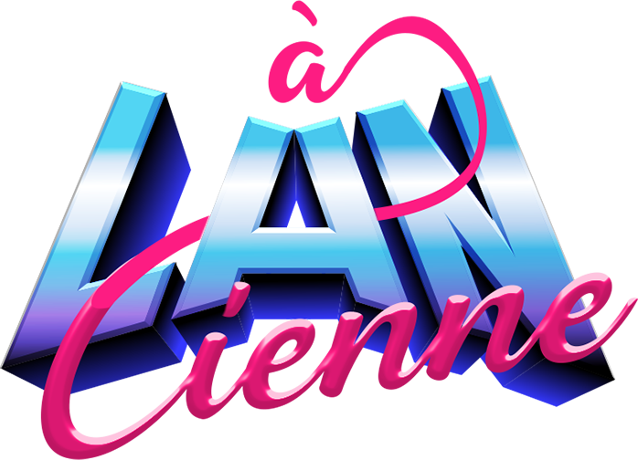

<p align="center">
  
</p>

<h1 align="center">Agar · À LAN Cienne</h1>

<p align="center">
  Le clone d'Agar.io de notre LAN rétro annuelle, aux couleurs néon de l'événement,<br>
  avec un mode tournoi piloté depuis une page d'administration.
</p>

---

Ce dépôt est une version modifiée de [owenashurst/agar.io-clone](https://github.com/owenashurst/agar.io-clone) (Node.js, Socket.IO, canvas HTML5). Le principe du jeu ne change pas : on dirige une cellule, on mange des pastilles et les joueurs plus petits, et on évite les plus gros.

**Ce qui a été ajouté :**

- **Thème « À LAN Cienne »** : fond bleu nuit et grille néon, palette rose, violet et cyan, halo lumineux autour des cellules, logo et interface en français.
- **Deux modes de jeu**, à choisir depuis la page admin :
  - **FFA** : la partie sans fin habituelle, avec le top 10.
  - **War** : un tournoi chronométré, avec classement complet, points calculés automatiquement et cumul sur plusieurs rounds.
- **Page d'administration** (`/admin.html`) : choix du mode, chrono, réglages, classement en direct, résultats et export CSV.
- **Écran géant** : `/?spectate` affiche toute la carte, le chrono et les résultats, pour un projecteur.

## Lancer le serveur

Il faut [Docker](https://www.docker.com/).

```bash
git clone https://github.com/Yatoo2/agario-alancienne.git
cd agario-alancienne
docker build -t agarioclone_agar .

mkdir -p /chemin/vers/agario-data
docker run -it -p 3002:3000 \
  -e ADMIN_PASS=UnMotDePasseSolide \
  -v /chemin/vers/agario-data:/usr/src/app/bin/server/db \
  agarioclone_agar
```

| Adresse | Pour qui |
|---|---|
| `http://IP-DU-SERVEUR:3002/` | les joueurs |
| `http://IP-DU-SERVEUR:3002/admin.html` | l'organisateur |
| `http://IP-DU-SERVEUR:3002/?spectate` | l'écran géant |

> [!IMPORTANT]
> - **`ADMIN_PASS`** : sans cette variable, le mot de passe admin est `DEFAULT`. La page admin affiche alors un avertissement.
> - **Le volume `-v`** garde les résultats des tournois et les réglages. Sans lui, tout est perdu si le conteneur est recréé.

Au démarrage, le conteneur vérifie le code et lance les tests avant de démarrer le serveur. Comptez une dizaine de secondes avant que le jeu réponde.

## Jouer

| Action | Commande |
|---|---|
| Se déplacer | la souris (ou les flèches) |
| Se diviser | `Espace` |
| Éjecter de la masse | `W` |
| Discuter | `Entrée` |
| Classement complet ou compact (mode War) | `Tab` |

Les pseudos acceptent les lettres, les chiffres et `_` (pas d'accents ni d'espaces). En mode War, le pseudo est obligatoire et doit être unique.

Les virus (contour rose et piquant) font éclater les cellules plus grosses qu'eux.

## Le mode War (tournoi)

Par défaut, un tournoi compte **3 rounds de 15 minutes**. Les phases s'enchaînent automatiquement :

```
pas live (30 s) → LIVE (15 min) → résultats + pause (5 min) → pas live → LIVE → … → vainqueur
```

| Phase | Ce qui se passe |
|---|---|
| **Pas live** | Les joueurs se connectent et bougent, mais personne ne peut manger, se diviser ni éjecter. Décompte 5-4-3-2-1 puis « GO ! ». |
| **LIVE** | Tout le monde repart de la masse de base, à des positions réparties. Le classement affiche **tous** les joueurs connectés. Le bandeau devient rose pendant la dernière minute. |
| **Fin de round** | Le jeu se fige. Chaque joueur gagne **autant de points que sa masse** à cet instant (un joueur mort marque 0). Le classement du round et le cumul s'affichent chez tout le monde. |
| **Pause** | Le jeu reste figé jusqu'au round suivant. |
| **Tournoi terminé** | Le vainqueur, celui qui a le plus de points cumulés, est affiché. |

**Règles d'équité :**

- **Protection au départ** : au « GO ! », et quand un joueur réapparaît pendant un round, sa cellule est protégée pendant quelques secondes (5 s par défaut). Elle ne peut ni manger ni être mangée, et un anneau cyan clignote autour d'elle.
- **Déconnexion** : pendant un tournoi, la cellule d'un joueur déconnecté reste dans l'arène, immobile et marquée « (déco) ». Elle peut toujours être mangée, donc se déconnecter ne protège pas. Si le joueur revient **depuis le même PC** avec le même pseudo, il récupère sa cellule. Personne d'autre ne peut prendre ce pseudo entre-temps.

### Page d'administration

Connectez-vous sur `/admin.html` avec le mot de passe `ADMIN_PASS`.

- **Mode de jeu** : FFA ou War. Le changement de mode est bloqué pendant un tournoi.
- **Tournoi** :
  - **Lancer un nouveau tournoi** : le cumul repart de zéro ; les anciens résultats restent en base.
  - **Reprendre le dernier** : après un redémarrage du serveur, le tournoi reprend au round suivant avec son cumul.
  - **Phase suivante** : passe immédiatement à la phase suivante, par exemple pour terminer un round plus tôt.
  - **+1 min** : prolonge le chrono en cours.
  - **Arrêter** : le round en cours n'est pas comptabilisé.
- **Réglages** : nombre de rounds, durée d'un round, durée du « pas live », durée de la pause et durée de la protection. Ils s'appliquent **à partir de la phase suivante** et restent enregistrés après un redémarrage.
- **Classement en direct**, **dernier round** et **cumul**, avec un **export CSV** de chacun (s'ouvre dans Excel).

## Configuration

Les variables d'environnement se passent avec `-e NOM=valeur` à `docker run`.

| Variable | Défaut | Rôle |
|---|---|---|
| `ADMIN_PASS` | `DEFAULT` | Mot de passe de la page admin et de la commande `-login` |
| `WAR_ROUNDS` | `3` | Nombre de rounds |
| `WAR_ROUND_SECONDS` | `900` | Durée d'un round |
| `WAR_WARMUP_SECONDS` | `30` | Durée du « pas live » |
| `WAR_PAUSE_SECONDS` | `300` | Durée de la pause entre les rounds |

Les variables `WAR_*` ne servent que de **valeurs de départ**. Dès que des réglages sont enregistrés depuis la page admin, ils prennent le dessus. Ils sont stockés dans `war-settings.json`, dans le volume ; supprimez ce fichier pour revenir aux variables.

Les autres paramètres du jeu (taille de la carte, nombre de pastilles et de virus, vitesse…) se trouvent dans [`config.js`](config.js). Il faut reconstruire l'image après les avoir modifiés.

### Données conservées dans le volume

| Fichier | Contenu |
|---|---|
| `db.sqlite3` | Résultats de chaque round (table `war_results`), messages du chat, tentatives de connexion admin échouées |
| `war-settings.json` | Réglages du mode War enregistrés depuis la page admin |

## Commandes du chat

Tapez-les dans le chat, précédées d'un tiret.

| Commande | Effet |
|---|---|
| `-help` | Liste des commandes |
| `-ping` | Affiche la latence |
| `-mass` / `-border` | Affiche la masse / les bords de la carte |
| `-dark` | Bascule entre le fond néon et un fond noir |
| `-login <mot de passe>` | Se connecter comme admin en jeu |
| `-kick <pseudo> [raison]` | Expulser un joueur (admin) |

## Développement

```bash
npm install
npm run watch   # serveur + reconstruction automatique sur http://localhost:3000
npm test        # vérification du code + tests
```

| Fichier | Rôle |
|---|---|
| `src/server/tournament.js` | Déroulement des modes FFA et War (phases, chrono, points, cumul) |
| `src/server/server.js` | Serveur de jeu, connexion de la page admin, pseudos uniques, joueurs déconnectés |
| `src/client/js/war-ui.js` | Bandeau du chrono, classement complet, écran de résultats |
| `src/client/admin.html` | Page d'administration (autonome, sans build) |
| `src/client/css/main.css` | Thème « À LAN Cienne » |

### Récupérer les mises à jour du projet d'origine

```bash
git remote add upstream https://github.com/owenashurst/agar.io-clone.git   # une seule fois
git fetch upstream
git merge upstream/master
```

## Crédits et licence

- Jeu d'origine : [huytd/agar.io-clone](https://github.com/huytd/agar.io-clone), repris par [owenashurst/agar.io-clone](https://github.com/owenashurst/agar.io-clone) et ses contributeurs.
- Adaptation « À LAN Cienne » : thème, modes FFA/War et administration.

Distribué sous licence **MIT**, comme le projet d'origine. Voir [LICENSE](LICENSE).
